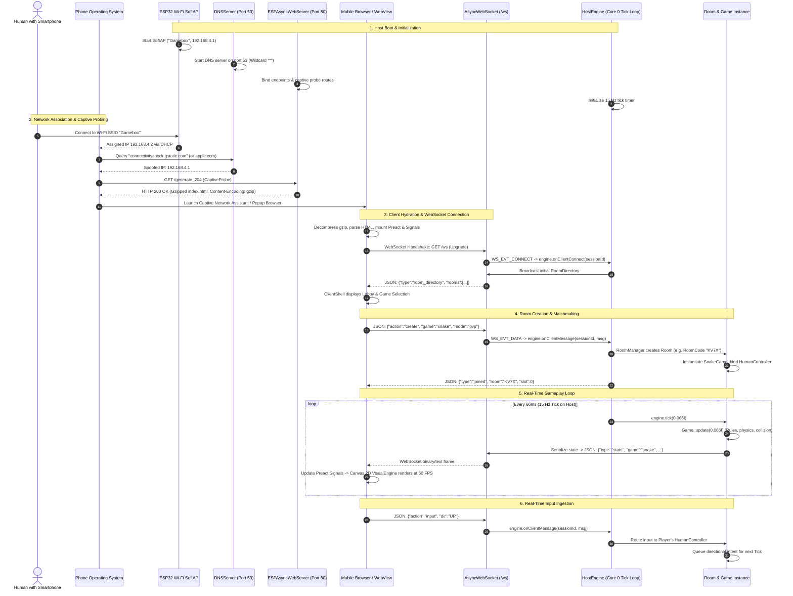

# 01. End-to-End Lifecycle: Power-On to Playable Match

This document traces the complete, chronological lifecycle of Gamebox: from the moment the **Host** microcontroller powers on to an interactive multiplayer match played from a mobile phone browser.

Each phase specifies the exact sequence of events, which libraries execute the code, and how data moves across the system boundaries.

---

## 🧭 High-Level Lifecycle Flow



---

## 🔬 Deep Dive: Step-by-Step Execution & Libraries

### Step 1: Microcontroller Boot & Peripherals Setup
* **Source Location**: [`src/esp32/main.cpp`](file:///c:/Users/Nikita/Documents/C++/src/esp32/main.cpp)
* **Libraries Involved**:
  - `WiFi` (Espressif ESP32 Arduino Core)
  - `DNSServer` (Arduino standard library)
  - `ESPAsyncWebServer` & `AsyncTCP` (`https://github.com/me-no-dev/ESPAsyncWebServer.git`, `AsyncTCP.git`)
  - `gamehub/core/HostEngine.hpp`
* **What happens**:
  1. The ESP32-S3 boots into Arduino `setup()`.
  2. `WiFi.mode(WIFI_AP)` switches the Wi-Fi radio to an open SoftAP broadcasting SSID `Gamebox`.
  3. The internal DHCP server assigns the Host the gateway IP `192.168.4.1`.
  4. `dnsServer.start(53, "*", apIP)` launches a lightweight UDP DNS server listening on port 53. Any DNS resolution query received for *any* domain (e.g., `apple.com`, `google.com`) returns `192.168.4.1`.
  5. `ESPAsyncWebServer server(80)` registers routes for the captive portal and web application.
  6. `HostEngine` is instantiated with an `ESP32NetworkAdapter` wrapping the `AsyncWebSocket`.

---

### Step 2: Client Wi-Fi Association & Captive Probing
* **Source Location**: [`src/esp32/main.cpp`](file:///c:/Users/Nikita/Documents/C++/src/esp32/main.cpp)
* **What happens**:
  1. When a smartphone connects to `Gamebox`, the OS attempts to verify internet connectivity by issuing a background HTTP probe (**CaptiveProbe**):
     - **Android**: `GET http://connectivitycheck.gstatic.com/generate_204` or `/gen_204`
     - **Apple iOS / macOS**: `GET http://captive.apple.com/hotspot-detect.html` or `/canonical.html`
     - **Windows**: `GET http://www.msftconnecttest.com/connecttest.txt` or `/ncsi.txt`
  2. Because the Host DNS server redirects all domains to `192.168.4.1`, these HTTP requests hit port 80 of the ESP32.
  3. Instead of returning a `204 No Content` or `Success` string, `ESPAsyncWebServer` returns the full single-page application with HTTP status `200 OK`:
     ```cpp
     auto serveSPA = [](AsyncWebServerRequest* request) {
         AsyncWebServerResponse* response = request->beginResponse(
             200, "text/html",
             gamehub::web::WebAssets::getIndexHtmlData(),
             gamehub::web::WebAssets::getIndexHtmlSize()
         );
         response->addHeader("Content-Encoding", "gzip");
         request->send(response);
     };
     ```
  4. The client OS recognizes that it did not receive the expected probe response, deduces it is behind a captive portal, and immediately displays a system notification or auto-pops the system browser ("Log in to Wi-Fi network").

---

### Step 3: Zero-Copy Asset Delivery from Flash Memory
* **Source Location**: [`include/gamehub/web/WebAssets.hpp`](file:///c:/Users/Nikita/Documents/C++/include/gamehub/web/WebAssets.hpp)
* **Libraries Involved**:
  - `ESPAsyncWebServer` zero-copy memory response
  - Native RFC 1952 Gzip flash chunk
* **What happens**:
  1. The client HTML, CSS, JavaScript, and SVG icons are compressed at build time into an inlined 28 KB binary array stored in flash memory (`PROGMEM`).
  2. `WebAssets::getIndexHtmlData()` returns a direct `const uint8_t*` pointer to flash.
  3. No file system lookup (SPIFFS/LittleFS) occurs; no RAM heap allocation is required to buffer the page.
  4. With `Content-Encoding: gzip`, the client browser natively decompresses the 28 KB stream into the full 105 KB DOM application in milliseconds.

---

### Step 4: Client Hydration & WebSocket Handshake
* **Source Location**:
  - Client: [`frontend/src/main.tsx`](file:///c:/Users/Nikita/Documents/C++/frontend/src/main.tsx), [`frontend/src/services/network.ts`](file:///c:/Users/Nikita/Documents/C++/frontend/src/services/network.ts)
  - Host: [`src/esp32/main.cpp`](file:///c:/Users/Nikita/Documents/C++/src/esp32/main.cpp), [`src/core/HostEngine.cpp`](file:///c:/Users/Nikita/Documents/C++/src/core/HostEngine.cpp)
* **Libraries Involved**:
  - **Client**: Preact (`preact`), Preact Signals (`@preact/signals`), standard browser `WebSocket` API.
  - **Host**: `AsyncWebSocket` (`ESPAsyncWebServer`), `INetworkAdapter`.
* **What happens**:
  1. The browser parses `index.html` and executes the bundle.
  2. Preact mounts the `ClientShell` into the DOM.
  3. A persistent WebSocket is opened to `ws://<location.host>/ws`.
  4. On the Host, `ws.onEvent` intercepts `WS_EVT_CONNECT`:
     ```cpp
     client->setCloseClientOnQueueFull(false);
     engine.onClientConnect(client->id());
     ```
  5. `HostEngine` creates a new `Session` keyed by the client's integer ID.
  6. The Host immediately transmits the current `RoomDirectory` state to the newly connected Session.
  7. The client Preact signal updates, displaying active rooms and game selection cards in the Lobby.

---

### Step 5: Room Creation & Controller Attachment
* **Source Location**:
  - Client: [`frontend/src/components/Lobby.tsx`](file:///c:/Users/Nikita/Documents/C++/frontend/src/components/Lobby.tsx)
  - Host: [`src/core/RoomManager.cpp`](file:///c:/Users/Nikita/Documents/C++/src/core/RoomManager.cpp), [`src/core/Room.cpp`](file:///c:/Users/Nikita/Documents/C++/src/core/Room.cpp)
* **What happens**:
  1. The player clicks "Create Room" (e.g. Snake, 2 Players).
  2. The browser sends:
     ```json
     {"action": "create", "game": "snake", "mode": "pvp"}
     ```
  3. `HostEngine::onClientMessage` passes the message to `RoomManager`.
  4. `RoomManager` generates an alphanumeric 4-character **RoomCode** (e.g. `"AB3K"`), instantiates a `Room`, and creates the appropriate `Game` subclass (`SnakeGame`).
  5. The creating Session is bound to Player slot 0 using a `HumanController`.
  6. If the game is configured for Solo / Bot play, slot 1 is populated with a `BotController`. If PvP, the room enters `RoomLifecycle::WAITING` until a second Client joins using the RoomCode.

---

### Step 6: 15 Hz Authoritative Tick Loop & 60 FPS Visual Presentation
* **Source Location**:
  - Host: [`src/esp32/main.cpp`](file:///c:/Users/Nikita/Documents/C++/src/esp32/main.cpp), [`src/core/HostEngine.cpp`](file:///c:/Users/Nikita/Documents/C++/src/core/HostEngine.cpp)
  - Client: [`frontend/src/engine/VisualEngine.ts`](file:///c:/Users/Nikita/Documents/C++/frontend/src/engine/VisualEngine.ts)
* **What happens**:
  1. **Host Tick (15 Hz)**:
     - In `loop()`, every 66ms (`now - lastTick >= 66`), `engine.tick(0.066f)` is called.
     - The game logic updates: snakes advance on the grid, balls bounce in Pong, collisions are tested, and win/loss states are resolved.
     - `Room::broadcastState()` serializes the game state to JSON using `ArduinoJson`.
     - `ESP32NetworkAdapter::sendToClient()` transmits the state packet.
     - **Backpressure Protection**: If a client's Wi-Fi link lags and its queue accumulates frames (`client->queueLen() >= 2`), the adapter drops stale real-time state frames to prevent ESP32 RAM exhaustion.
  2. **Client Presentation (60 FPS)**:
     - The browser WebSocket receives the JSON snapshot and updates the game state signal.
     - The `VisualEngine` runs on `requestAnimationFrame` at 60 FPS, completely decoupled from the 15 Hz network rate.
     - It interpolates positions, renders neon borders on the `CanvasGridLayer`, triggers camera shakes and particle effects via `JuiceEngine`, and plays synthesised audio via the Web Audio API.

---

### Step 7: Game Termination, Rematch & AutoDetachment
* **Source Location**: [`src/core/Room.cpp`](file:///c:/Users/Nikita/Documents/C++/src/core/Room.cpp), [`src/core/HostEngine.cpp`](file:///c:/Users/Nikita/Documents/C++/src/core/HostEngine.cpp)
* **What happens**:
  1. When game over conditions are met, the Host sets the room state to `RoomLifecycle::FINISHED`.
  2. The `SeriesScore` is updated on the Host and retained for the room.
  3. Both connected players see the game-over overlay and can click **Rematch**.
  4. If both players agree to a Rematch, the Game resets within the same room without disconnecting or returning to the Lobby.
  5. If a player leaves or disconnects, **AutoDetachment** unbinds the Session from the Room, notifies the remaining opponent, and safely transitions or dissolves the Room.
