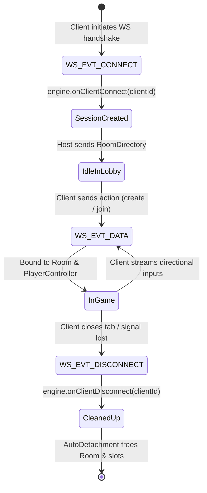

# 03. Network Transport & Concurrency

This document explains Gamebox's network transport architecture, WebSocket event handling, threading model, and backpressure mitigation strategies across both the ESP32-S3 and native desktop environments.

---

## ⚡ 1. The Cooperative Single-Core Concurrency Model (Core 0)

Early iterations of ESP32 game prototypes frequently run into race conditions and mutex overhead by running networking on one core and game physics on another.

Gamebox adopts a **cooperative single-core architecture** on Core 0 (documented in [ADR 0015](../adr/0015-cooperative-core-0-tick-loop-and-socket-thread-safety.md)):
- Networking (`ESPAsyncWebServer`, `AsyncTCP`, `AsyncWebSocket`) executes on Core 0.
- The authoritative game engine tick loop executes synchronously within the Arduino `loop()` on Core 0.
- **Benefits**:
  - Eliminates mutex locks and condition variables between network packet arrival and game room state updates.
  - Guarantees deterministic state mutation: inputs are processed sequentially between ticks, and state frames are generated cleanly at fixed intervals.

```cpp
void loop() {
    static uint32_t lastTick = 0;
    uint32_t now = millis();
    
    // 15 Hz Fixed-Interval Game Loop (every 66 ms)
    if (now - lastTick >= 66) {
        lastTick = now;
        engine.tick(0.066f);
    }
    
    // Service Port 53 DNS requests
    dnsServer.processNextRequest();
    
    // Purge disconnected or dead WebSocket client structures
    ws.cleanupClients();
    
    // Yield to FreeRTOS scheduler
    delay(5);
}
```

---

## 🔌 2. The `INetworkAdapter` Transport Seam

To maintain cross-platform portability between the ESP32-S3 and native desktop platforms (Windows, Linux, macOS), the core game engine has zero knowledge of microcontroller-specific network libraries.

All network transmission is abstracted behind the abstract interface [`INetworkAdapter`](file:///c:/Users/Nikita/Documents/C++/include/gamehub/core/INetworkAdapter.hpp):

```cpp
namespace gamehub::core {
class INetworkAdapter {
public:
    virtual ~INetworkAdapter() = default;
    virtual void sendToClient(uint32_t sessionId, const std::string& message) = 0;
    virtual void broadcast(const std::string& message) = 0;
};
}
```

### ESP32 Implementation (`ESP32NetworkAdapter`)
Inside [`src/esp32/main.cpp`](file:///c:/Users/Nikita/Documents/C++/src/esp32/main.cpp), this interface binds directly to `AsyncWebSocket`:
```cpp
class ESP32NetworkAdapter : public gamehub::core::INetworkAdapter {
public:
    explicit ESP32NetworkAdapter(AsyncWebSocket& websocket) : m_ws(websocket) {}
    
    void sendToClient(uint32_t sessionId, const std::string& message) override {
        AsyncWebSocketClient* client = m_ws.client(sessionId);
        if (client && client->status() == WS_CONNECTED) {
            // Apply backpressure flow-control
            if (shouldDropRealtimeFrame(message, client->queueLen())) {
                return;
            }
            client->text(message.c_str());
        }
    }

    void broadcast(const std::string& message) override {
        for (auto& client : m_ws.getClients()) {
            if (client.status() == WS_CONNECTED) {
                if (shouldDropRealtimeFrame(message, client.queueLen())) {
                    continue;
                }
                client.text(message.c_str());
            }
        }
    }
private:
    AsyncWebSocket& m_ws;
};
```

---

## 🛡️ 3. WebSocket Backpressure & Memory Protection

On embedded systems with limited RAM, real-time streaming over unstable Wi-Fi connections can quickly lead to fatal memory exhaustion. If a client device drops packets or lags:
1. Outgoing WebSocket frames accumulate in the client's internal send queue.
2. The `AsyncTCP` send buffer consumes heap RAM.
3. Eventually, the ESP32 crashes with out-of-memory errors.

### The Mitigation Strategy: Drop Stale Real-Time State Frames
For fast-paced real-time games (Snake, Pong, Tron) running at 15 Hz, a dropped state snapshot is harmless because a newer, more up-to-date snapshot will arrive in 66 ms.

Gamebox inspects outgoing payloads and client queue lengths:
```cpp
bool isRealtimeState = message.find("\"type\":\"state\"") != std::string::npos &&
                      (message.find("\"game\":\"snake\"") != std::string::npos ||
                       message.find("\"game\":\"pong\"") != std::string::npos ||
                       message.find("\"game\":\"tron\"") != std::string::npos);

if (isRealtimeState && client->queueLen() >= 2) {
    // Drop the frame to avoid queue backlog and heap exhaustion
    return;
}
```

* **Critical Messages (Guaranteed Delivery)**: Room creation (`joined`), game termination (`finished`), and rematch events are never dropped.
* **Transient State Messages (Drop Allowed)**: Real-time tick positions are throttled if the client queue has 2 or more pending frames.
* **Connection Stability**: `client->setCloseClientOnQueueFull(false)` prevents the server from aggressively terminating the connection when transient Wi-Fi jitter occurs.

---

## 🔄 4. WebSocket Event Lifecycle

WebSocket connection events are handled by the callback function `onWsEvent`:



1. **`WS_EVT_CONNECT`**:
   - Client establishes handshake on endpoint `/ws`.
   - `engine.onClientConnect(client->id())` assigns a new `Session`.
   - The Host sends the current list of active rooms.
2. **`WS_EVT_DATA`**:
   - Handled only when `info->final` and `info->opcode == WS_TEXT`.
   - Ingests incoming JSON actions:
     - `{"action":"create", ...}`
     - `{"action":"join", "code":"...", ...}`
     - `{"action":"input", "dir":"..."}`
     - `{"action":"leave"}`
     - `{"action":"rematch"}`
3. **`WS_EVT_DISCONNECT`**:
   - `engine.onClientDisconnect(client->id())` triggers **AutoDetachment**, cleaning up player allocations and removing empty rooms from the directory.

---

## 🖥️ 5. Desktop Runner Parity

For testing on developer machines without an ESP32:
- [`src/desktop/main.cpp`](file:///c:/Users/Nikita/Documents/C++/src/desktop/main.cpp) implements a native desktop HTTP and WebSocket server.
- Uses standard POSIX sockets on Linux/macOS and Winsock2 (`ws2_32`) on Windows.
- Implements the exact same `INetworkAdapter` interface.
- Desktop clients connect to `http://localhost:8080`, running the exact same client shell and authoritative game engine.
