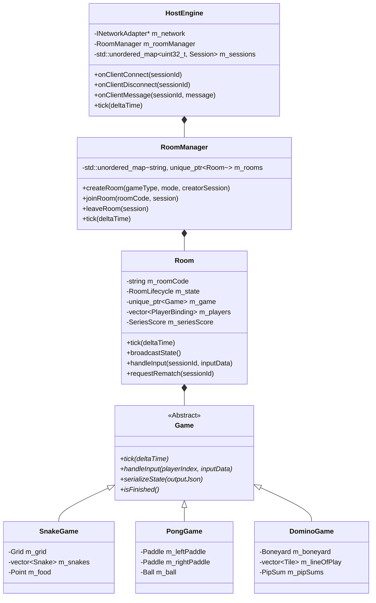
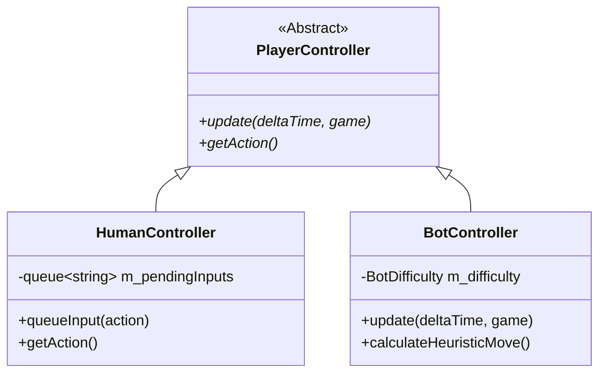

# 04. Authoritative C++17 Game Engine

This document details the core headless C++17 game engine (`src/core/`), covering room management, state snapshot generation, game polymorphism, player controllers, and zero-heap allocation patterns.

---

## 🏛️ 1. Headless Architecture & Domain Hierarchy

Gamebox is built around an **authoritative server model** (documented in [ADR 0001](../adr/0001-authoritative-cpp-engine-thin-web-client.md)). The **Host** maintains the authoritative source of truth for all game rules, positions, velocities, collisions, and scores. Connected **Clients** are strictly presentation shells that stream input events and render authoritative snapshots.

---

## 🎮 2. Polymorphic Game Hierarchy

All games implement the abstract base interface [`Game`](file:///c:/Users/Nikita/Documents/C++/include/gamehub/core/Game.hpp):
- `tick(float dt)`: Advances the game simulation by a delta time slice.
- `handleInput(uint32_t playerIndex, const std::string& action)`: Ingests intent from a player controller.
- `serializeState(std::string& out)`: Produces a compact JSON state snapshot broadcast to connected clients.
- `isFinished()` / `getWinner()`: Queries game outcome and victory conditions.

### Implemented Game Catalog:
1. **SnakeGame** (`SnakeGame.cpp`): 1–2 player real-time snake with wrap-around boundaries, food spawning, self/opponent body collision, and speed progression.
2. **PongGame** (`PongGame.cpp`): 2-player real-time arcade pong with ball physics, angle reflection, paddle velocity, and score limit.
3. **TronGame** (`TronGame.cpp`): 2-player high-speed lightcycle arena with persistent trail collisions.
4. **TicTacToeGame** (`TicTacToeGame.cpp`): Turn-based 3x3 grid with win-line verification and minimax bot fallback.
5. **ConnectFourGame** (`ConnectFourGame.cpp`): Turn-based 7x6 gravity grid with horizontal, vertical, and diagonal sequence detection.
6. **BattleshipGame** (`BattleshipGame.cpp`): Turn-based naval warfare with fog-of-war, ship placement, hit/miss tracking, and sunk fleet alerts.
7. **DominoGame** (`DominoGame.cpp`): Turn-based Double-Six draw dominoes supporting 2–3 players, Boneyard draws, legal-end matching, and PipSum tie-breaking.

---

## 🕹️ 3. PlayerController Strategy Pattern

A **Player** in a game can be controlled either by a human connecting from a remote browser or by an autonomous bot running on the Host. The engine decouples input generation using the **PlayerController** pattern:

* **`HumanController`**: Stores directional or move intents queued from incoming WebSocket packets.
* **`BotController`**: Computes moves autonomously during `tick()`. For real-time games (Pong, Tron), it tracks entity positions and interpolates reaction times. For turn-based games (TicTacToe, ConnectFour), it evaluates state heuristics or mini-max trees.

---

## ⚡ 4. Zero-Heap Allocation & Value Semantics

Running on an embedded microcontroller with tens of kilobytes of available dynamic memory demands extreme caution regarding dynamic heap fragmentation (`malloc` / `new`).

The engine adheres to **FunctionalStateCore** and **GameplayCore** design rules (documented in [ADR 0016](../adr/0016-gameplay-core-and-canvas-grid-layer.md)):
1. **Fixed-Size Grids**: Game boards (e.g. TicTacToe `3x3`, ConnectFour `7x6`, Snake `24x24`) use stack-allocated, compile-time `std::array` buffers rather than dynamic nested `std::vector<std::vector<int>>`.
2. **Plain Old Data (POD) Structs**: Entity states (positions, velocities, tile IDs) are compact value types copied by value without pointer indirection.
3. **Reused Serialization Buffers**: State snapshot serialization formats directly into reused output streams or stack buffers, eliminating repeated string reallocations during the 15 Hz tick loop.
4. **AutoDetachment**: When players disconnect or games finish, rooms are systematically dissolved and deallocated to prevent lingering orphan memory.
