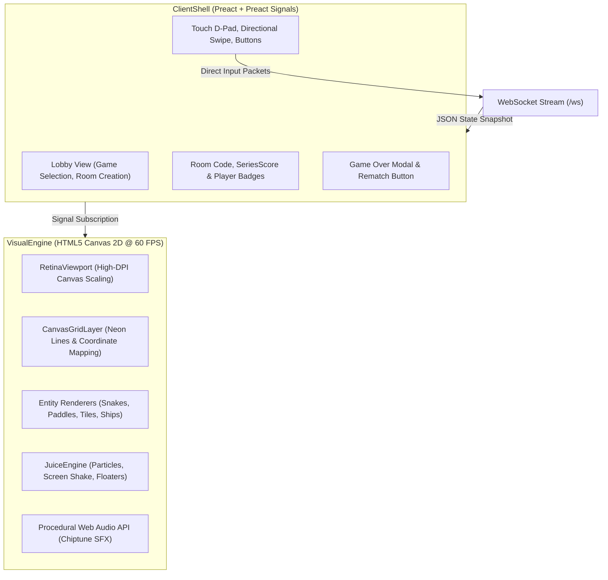

# 05. Client Shell & Visual Engine

This document details the frontend client architecture (`frontend/src/`), explaining the clean separation between the reactive DOM user interface (**ClientShell**) and the 60 FPS HTML5 Canvas presentation layer (**VisualEngine**).

---

## 🎨 1. Architectural Seam: Shell vs. Canvas

To deliver a snappy, 60 FPS arcade experience on constrained mobile browsers while maintaining maintainable UI controls, Gamebox strictly isolates two concerns:



* **ClientShell**: Handles HTML DOM rendering, room directory lists, overlays, buttons, and user inputs. It is driven reactively by Preact Signals whenever network packets arrive.
* **VisualEngine**: Renders the game arena using HTML5 Canvas 2D on a dedicated `requestAnimationFrame` loop at 60 FPS. It does not manipulate the DOM, ensuring zero layout thrashing or garbage collector stutter during active gameplay.

---

## ⚡ 2. State Management with Preact Signals

Instead of heavy frontend frameworks or bulky global store libraries (Redux, Zustand), Gamebox uses **Preact** paired with **Preact Signals** (`@preact/signals`).

### Why Signals?
1. **Fine-Grained Updates**: Signals update specific DOM elements or Canvas callbacks directly without triggering unnecessary component re-renders across the entire tree.
2. **Minimal Bundle Size**: Preact + Preact Signals compiles to under 15 KB uncompressed, fitting comfortably within the single-file HTML bundle.
3. **Decoupled Architecture**: The network transport updates reactive signals directly upon receiving WebSocket messages:
   ```typescript
   export const currentGameState = signal<GameState | null>(null);
   export const roomDirectory = signal<RoomInfo[]>([]);
   export const activeRoomCode = signal<string | null>(null);
   export const seriesScore = signal<{ p1: number, p2: number }>({ p1: 0, p2: 0 });
   ```

---

## 📺 3. The Visual Engine & High-DPI Rendering

The presentation pipeline lives in `frontend/src/engine/VisualEngine.ts`.

### RetinaViewport
Mobile devices feature high pixel density displays (e.g. 2x or 3x device pixel ratio). Rendering directly to a standard canvas creates blurry lines and fuzzy text.

`RetinaViewport` automatically scales the HTML5 Canvas backing store by `window.devicePixelRatio`, clamped to `2.0` to balance battery life and crisp rendering:
```typescript
const dpr = Math.min(window.devicePixelRatio || 1, 2.0);
canvas.width = displayWidth * dpr;
canvas.height = displayHeight * dpr;
ctx.scale(dpr, dpr);
```

### CanvasGridLayer
Provides zero-overhead grid rendering for discrete games (Snake, Tron, Connect Four, Battleship):
- Calculates dynamic cell dimensions based on canvas aspect ratio.
- Draws anti-aliased neon borders with subtle glows.
- Translates pointer/touch screen coordinates into grid coordinates for board clicks.

---

## 💥 4. Sensory Feedback: The JuiceEngine

Game polish ("game juice") elevates simple 2D games into engaging arcade experiences. The **JuiceEngine** coordinates procedural sensory feedback:
- **Particle Emitters**: Spawns burst particles upon food consumption, paddle hits, trail impacts, or ship explosions.
- **Camera Shake**: Injects smooth decaying 2D coordinate offsets (`shakeX`, `shakeY`) during collisions or victories.
- **Floating Text Popups**: Renders rising retro score popups (`+10`, `CRITICAL HIT!`, `DRAW`) that fade out dynamically.

---

## 🔊 5. Procedural Audio via Web Audio API

To eliminate the need for audio file assets (MP3/WAV/OGG) that would inflate flash memory:
- All sound effects are procedurally synthesized in real time using the browser's native `AudioContext`.
- Chiptune tones, square-wave bounces, noise bursts for explosions, and celebratory arpeggios are generated via frequency sweeps on oscillators.
- Audio activates on the first user interaction, conforming to mobile browser autoplay security policies.
