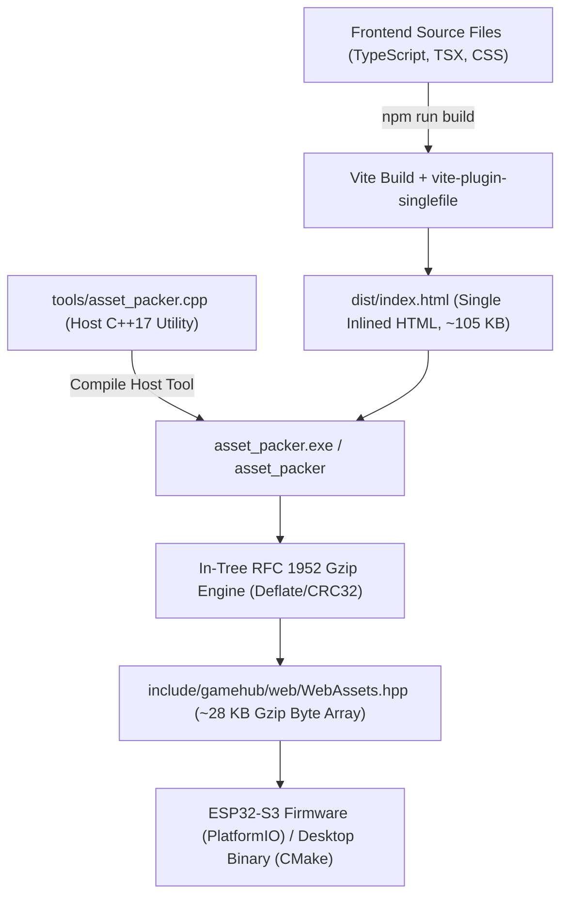

# 06. Native C++ Asset Pipeline & Compression

This document details the build-time asset compilation pipeline that packages the Preact web frontend into an embedded C++ header file (`WebAssets.hpp`), detailing the transition to a 100% C++ toolchain with in-tree RFC 1952 Gzip compression.

---

## 🏗️ 1. Pipeline Overview

Gamebox requires zero filesystem partitions (LittleFS/SPIFFS) on the ESP32-S3. The entire web application—including HTML, JavaScript, CSS styles, and Lucide vector icons—is compiled directly into the firmware binary as flash memory chunks (`PROGMEM`).



---

## ⚙️ 2. Step 1: Frontend Inlining via Vite

In `frontend/vite.config.ts`:
```typescript
import { defineConfig } from 'vite';
import preact from '@preact/preset-vite';
import { viteSingleFile } from 'vite-plugin-singlefile';

export default defineConfig({
  plugins: [preact(), viteSingleFile()],
  build: {
    target: 'esnext',
    assetsInlineLimit: 100000000, // Inline all SVGs, fonts, and assets
    cssCodeSplit: false,
    minify: 'terser',
  },
});
```

* `vite-plugin-singlefile` bundles all JavaScript modules, stylesheets, and SVG components into a single standalone `dist/index.html` file.
* This eliminates secondary HTTP requests (`/style.css`, `/bundle.js`, `/favicon.ico`) over the captive portal Wi-Fi network, ensuring immediate offline execution.

---

## 🗜️ 3. Step 2: Native C++ `asset_packer` & In-Tree Gzip Engine

Previously, an external Python script was invoked to turn `index.html` into a C++ header. To fulfill strict academic and production requirements for a **100% pure C++ toolchain** (documented in [ADR 0018](../adr/0018-cxx-asset-packer-and-gzip-compression.md)), this was replaced by a native C++ utility: [`tools/asset_packer.cpp`](file:///c:/Users/Nikita/Documents/C++/tools/asset_packer.cpp).

### Key Features of `asset_packer`:
1. **Zero External Dependencies**: Compiles with standard MSVC on Windows, GCC, or Clang without requiring `vcpkg`, `conan`, or external libraries like `zlib.dll`.
2. **In-Tree RFC 1952 Compression**: Implements LZ77 compression, static Huffman encoding, and CRC-32 checksum calculation within the source tree.
3. **Footprint Reduction**:
   - Uncompressed HTML: **105,320 bytes**
   - Gzipped FlashChunk: **28,140 bytes** (~73% reduction)
   - Code lines in `WebAssets.hpp`: Reduced from >5,200 lines to ~1,400 lines, dramatically reducing git diff noise.

---

## 📦 4. The Generated Header Interface (`WebAssets.hpp`)

The generated header provides a zero-copy API consumed identically by the ESP32 firmware and the desktop runner:

```cpp
namespace gamehub::web {
class WebAssets {
public:
    static const uint8_t* getIndexHtmlData() {
        return INDEX_HTML_GZ_DATA;
    }
    
    static size_t getIndexHtmlSize() {
        return sizeof(INDEX_HTML_GZ_DATA);
    }
    
    static constexpr bool isGzipped() {
        return true;
    }
};
}
```

* On ESP32, `INDEX_HTML_GZ_DATA` resides in `PROGMEM` (flash memory).
* `ESPAsyncWebServer` serves it directly with `Content-Encoding: gzip` without touching heap RAM.

---

## 🛠️ 5. Build Automation in CMake

The root [`CMakeLists.txt`](file:///c:/Users/Nikita/Documents/C++/CMakeLists.txt) configures the asset packer as a native host build target and sets up a build dependency:

```cmake
# Compile host-native asset packer utility
add_executable(asset_packer tools/asset_packer.cpp)

# Define custom command to generate WebAssets.hpp when index.html changes
add_custom_command(
    OUTPUT ${CMAKE_CURRENT_SOURCE_DIR}/include/gamehub/web/WebAssets.hpp
    COMMAND asset_packer
            ${CMAKE_CURRENT_SOURCE_DIR}/frontend/dist/index.html
            ${CMAKE_CURRENT_SOURCE_DIR}/include/gamehub/web/WebAssets.hpp
    DEPENDS asset_packer
            ${CMAKE_CURRENT_SOURCE_DIR}/frontend/dist/index.html
    COMMENT "Packaging and compressing frontend assets into WebAssets.hpp"
)
```

Running `cmake --build build` automatically compiles `asset_packer`, runs compression, and links the resulting asset header into the desktop binary and test suites.
