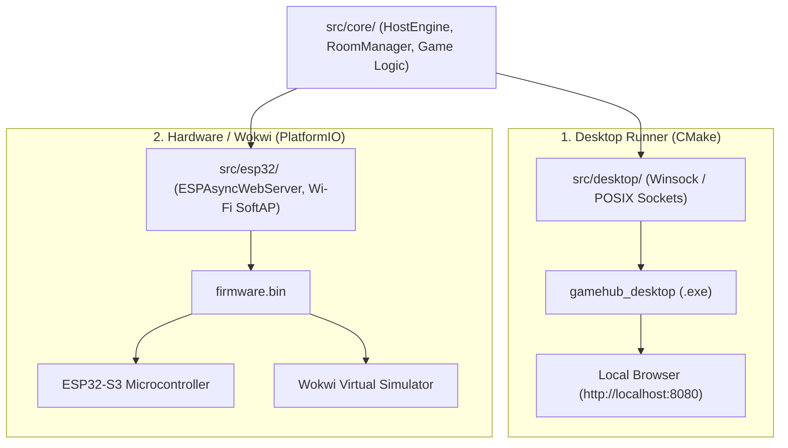

# 07. Dual-Target Desktop & Hardware Simulation

This document explains Gamebox's dual-target development workflow, allowing rapid local testing on desktop operating systems (Windows, Linux, macOS), simulation in Wokwi, and flashing to ESP32-S3 hardware.

---

## 🎯 1. Why Dual-Target Development?

Embedded microcontroller firmware development typically suffers from slow feedback loops:
1. Flashing over USB takes 15–45 seconds per iteration.
2. Debugging crashes on hardware often requires JTAG probes or serial print debugging.
3. Automated CI/CD pipelines in GitHub Actions do not have physical microcontrollers attached.

To solve this, Gamebox decouples all core game logic into platform-agnostic C++17 modules (`src/core/`), allowing developers to compile and test on desktop machines in seconds.



---

## 💻 2. Option 1: Native Desktop Runner (CMake)

The desktop server implementation (`src/desktop/main.cpp`) implements an HTTP and WebSocket server using native platform socket APIs:
- **Windows**: Links standard Windows Sockets (`ws2_32`).
- **Linux / macOS**: Uses standard POSIX sockets and pthreads.

### Building and Running:
```bash
# Configure and build
cmake -B build
cmake --build build --config Release

# Launch desktop server
./build/Release/gamehub_desktop.exe   # Windows
./build/gamehub_desktop               # Linux / macOS
```

The server opens on `http://localhost:8080`. Developers can open multiple browser tabs or incognito windows to test multiplayer games locally without any hardware.

---

## 🔌 3. Option 2: ESP32-S3 Hardware (PlatformIO)

The microcontroller firmware is configured via [`platformio.ini`](file:///c:/Users/Nikita/Documents/C++/platformio.ini):

```ini
[env:esp32-s3-devkitc-1]
platform = espressif32
board = esp32-s3-devkitc-1
framework = arduino
monitor_speed = 115200

build_flags = 
    -std=gnu++17
    -Iinclude
    -D ARDUINO_USB_CDC_ON_BOOT=1
    -D ARDUINO_USB_MODE=1

build_src_filter =
    +<core/*>
    +<esp32/*>
    -<desktop/*>
```

### Commands:
```bash
# Build firmware binary
pio run

# Flash to connected ESP32-S3 board
pio run -t upload

# Monitor serial debug output
pio device monitor
```

---

## 🌐 4. Option 3: Wokwi Hardware Simulation

For browser-based or VS Code simulation without physical hardware:
- [`diagram.json`](file:///c:/Users/Nikita/Documents/C++/diagram.json): Defines the virtual ESP32-S3 board wiring.
- [`wokwi.toml`](file:///c:/Users/Nikita/Documents/C++/wokwi.toml): Points to the compiled firmware binary generated by PlatformIO (`.pio/build/esp32-s3-devkitc-1/firmware.bin`).

Developers can press `F1` in VS Code and run `Wokwi: Start Simulator` to simulate the firmware, Wi-Fi AP, and serial monitor directly inside the editor.
