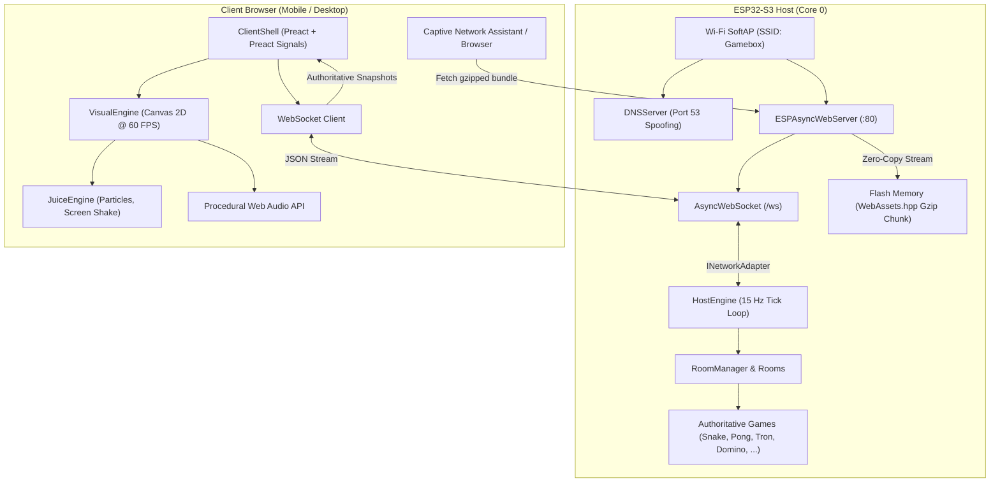

# Gamebox Architecture Documentation

Welcome to the internal engineering documentation for **Gamebox** (ESP32 Game Hub)—an authoritative headless game engine running on an ESP32-S3 microcontroller that hosts multiplayer and solo games over an offline local Wi-Fi captive portal and WebSocket transport.

---

## 📚 Document Index

1. [**01. End-to-End Lifecycle: Power-On to Playable Match**](./01-end-to-end-lifecycle.md)
   - Step-by-step walkthrough of the entire execution sequence.
   - Booting the microcontroller, SoftAP activation, Port 53 DNS wildcard redirection.
   - Operating system captive probe detection (`/generate_204`, `/hotspot-detect.html`).
   - Zero-copy flash streaming, Preact hydration, WebSocket handshake, and authoritative gameplay loop.
   - Exact C++ and web libraries utilized at each step.

2. [**02. Host Firmware & Captive Portal Architecture**](./02-esp32-host-and-captive-portal.md)
   - Microcontroller initialization (`WiFi.mode(WIFI_AP)`), SoftAP subnet (`192.168.4.1`).
   - DNS wildcard spoofing via `DNSServer`.
   - OS-specific captive probe routes and automatic browser trigger.
   - Zero-copy streaming from ESP32 flash memory (`PROGMEM`) with RFC 1952 Gzip decompression headers.

3. [**03. Network Transport & Concurrency**](./03-network-transport-and-concurrency.md)
   - Asynchronous networking with `AsyncTCP` and `ESPAsyncWebServer`.
   - Thread-safe cooperative single-core design: running the 15 Hz game engine tick loop alongside networking on Core 0.
   - WebSocket frame parsing and event handling (`WS_EVT_CONNECT`, `WS_EVT_DISCONNECT`, `WS_EVT_DATA`).
   - State frame backpressure management (`queueLen() >= 2` frame drops to prevent heap starvation).
   - Desktop network abstraction parity (`INetworkAdapter` / Winsock / BSD sockets).

4. [**04. Authoritative C++17 Game Engine**](./04-authoritative-game-engine.md)
   - Headless domain architecture: `HostEngine`, `RoomManager`, `Room`, `Session`.
   - Polymorphic `Game` interface and zero-heap design principles.
   - Deterministic 15 Hz tick loop and state snapshot serialization using `ArduinoJson` / standard streams.
   - Multi-game models: Snake, Pong, Tron, Domino, Tic-Tac-Toe, Battleship, Connect Four.
   - Controller abstraction: `PlayerController`, `HumanController`, and autonomous `BotController`.

5. [**05. Client Shell & Visual Engine**](./05-client-shell-and-visual-engine.md)
   - Single-page application frontend built with Preact and `@preact/signals`.
   - Strict architectural seam: Reactive DOM UI (`ClientShell`) vs. 60 FPS HTML5 Canvas 2D presentation (`VisualEngine`).
   - High-DPI screen scaling via `RetinaViewport`.
   - Procedural sensory feedback via `JuiceEngine` (particles, camera shake, floating indicators).
   - Audio synthesized via Web Audio API without sound assets.

6. [**06. Native C++ Asset Pipeline & Compression**](./06-asset-pipeline-and-compression.md)
   - The build-time journey: TypeScript/JSX source files -> Vite single-file bundler -> `tools/asset_packer` -> `WebAssets.hpp`.
   - Pure C++17 asset compilation pipeline replacing Python dependencies.
   - In-tree RFC 1952 Gzip compression achieving ~73% flash footprint reduction.
   - Zero LittleFS/SPIFFS filesystem partitioning: embedding frontend directly into flash chunks.

7. [**07. Dual-Target: Desktop Runner & Physical ESP32 Hardware**](./07-dual-target-desktop-and-simulation.md)
   - Native desktop runner (`src/desktop/main.cpp`) for zero-hardware rapid development, CI, and grading.
   - CMake build system configuration vs. PlatformIO ESP32-S3 firmware build.
   - Decoupled hardware-agnostic C++17 core engine architecture.

---

## 🏛️ System Architecture Overview

---

## 📖 Canonical Domain Terminology
All architecture documentation rigorously adheres to the terminology defined in [`CONTEXT.md`](../../CONTEXT.md). Key terms:
- **Host**: The physical ESP32-S3 microcontroller running the authoritative C++ game engine, HTTP server, and WebSocket transport (never "board" or "device").
- **Client**: A connected mobile or desktop web browser rendering game state and sending inputs (never "user" or "player").
- **Session**: An active, stateful network connection associated with a single connected Client (never "socket").
- **Player**: A participant inside a Game, controlled by a Session or Bot (never "account").
- **Room**: An isolated execution environment pairing Sessions to a single Game instance.
- **Tick**: A single fixed-interval execution step of the real-time loop on the Host (never "frame").
